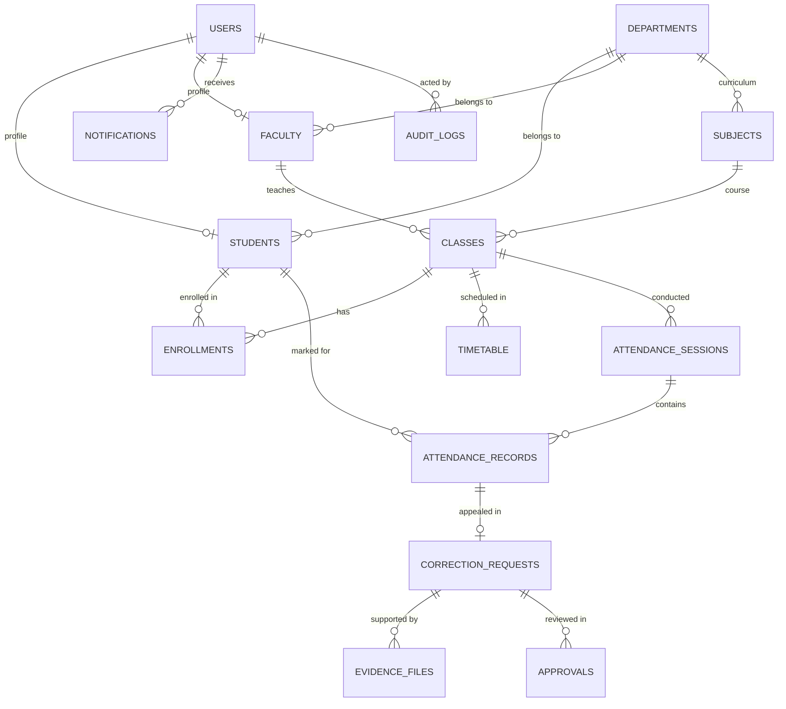

# CampusOne - Architecture Specification

## 1. System Architecture Overview

CampusOne follows a clean, decoupled, layered client-server architecture:
- **Client Tier**: Single Page Application (SPA) powered by React 19, TypeScript, Vite, Tailwind CSS, and Lucide icons.
- **API Tier**: High-performance RESTful API using FastAPI (Python 3.14), asynchronous handlers, Pydantic v2 data validation, and JWT authentication.
- **Persistence Tier**: PostgreSQL 18 relational database managed via SQLAlchemy 2.0 ORM and Alembic schema migrations.
- **Cryptographic Audit Layer**: SHA-256 linked-list hashing ensuring an immutable, tamper-evident audit ledger for every attendance correction event.

```
+-----------------------------------------------------------------------+
|                              CampusOne                                |
|                        Front-End (React + Vite)                       |
|   +-------------------+  +--------------------+  +----------------+   |
|   | Student Portal    |  | Faculty Portal     |  | Admin/HOD      |   |
|   | - Stats & QR Gen  |  | - HTML5 QR Scanner |  | - Master Mgmt  |   |
|   | - History/Request |  | - Manual Toggles   |  | - Audit Trail  |   |
|   +-------------------+  +--------------------+  +----------------+   |
+-----------------------------------------------------------------------+
                                  |
                                  | HTTP / JSON REST + JWT Bearer
                                  v
+-----------------------------------------------------------------------+
|                          FastAPI Backend                              |
|  [Auth Middleware & RBAC (Student, Faculty, Admin, HOD)]              |
|  +---------------------+  +---------------------+  +---------------+  |
|  | Routers:            |  | Services:           |  | Security:     |  |
|  | /auth, /students,   |  | AttendanceEngine,   |  | Passlib/Bcrypt|  |
|  | /faculty, /classes, |  | QRTokenValidator,   |  | Jose JWT      |  |
|  | /corrections,       |  | AuditHashChain,     |  | Role Guards   |  |
|  | /audit, /analytics  |  | NotificationCenter  |                 |  |
|  +---------------------+  +---------------------+  +---------------+  |
+-----------------------------------------------------------------------+
                                  |
                                  | SQLAlchemy 2.0 ORM (Async / Sync)
                                  v
+-----------------------------------------------------------------------+
|                    PostgreSQL 18 Database                             |
|  - Users & Roles (students, faculty, admins, hods)                    |
|  - Academic Structure (departments, subjects, classes, timetables)    |
|  - Attendance Sessions & Records (present, absent, late, excused)     |
|  - Correction Requests, Evidence Files & Multi-Tier Approvals         |
|  - Immutable Audit Logs (Cryptographic SHA-256 hash chaining)         |
|  - Ephemeral QR Tokens & In-App Notifications                         |
+-----------------------------------------------------------------------+
```

## 2. Security & Integrity Model

### 2.1 Role-Based Access Control (RBAC)
- **Roles**:
  - `admin`: Superuser managing institution entities, viewing global reports, system audit logs, and system settings.
  - `hod`: Head of Department, managing departmental faculty, subject allocations, and high-level correction escalations.
  - `faculty`: Instructors taking attendance (via QR scanning or manual lists), reviewing student correction requests, and monitoring class performance.
  - `student`: View personal attendance percentage, generate time-bound personal QR code, submit attendance correction requests with attached documentary proof.

### 2.2 SHA-256 Hash Chained Audit Trail
Every time an attendance record or correction status transitions:
1. Fetch `prev_hash` of the latest audit record (or genesis hash `0000000000000000000000000000000000000000000000000000000000000000` for the first record).
2. Canonicalize metadata:
   `raw = f"{prev_hash}|{table_name}|{record_id}|{action}|{actor_id}|{old_values}|{new_values}|{timestamp.isoformat()}"`
3. Compute `current_hash = hashlib.sha256(raw.encode()).hexdigest()`.
4. Store in `audit_logs` table.
5. The audit verification endpoint verifies `hash(n) == computed_hash` and `hash(n-1) == recorded_prev_hash`. If any row in the database is modified or deleted directly in SQL, the cryptographic chain is broken immediately.

### 2.3 Time-Limited QR Attendance System
1. Students request an active QR token from their portal.
2. The server generates a unique JWT-backed, 30-minute rotating token signed with institution keys, containing student ID and timestamp.
3. Faculty scans the student's QR code using their smartphone camera or laptop webcam via `html5-qrcode`.
4. The server decodes the token, validates the time window, verifies class enrollment, registers the attendance record, prevents replay attacks, and generates an audit log.

## 3. Database Schema Entity Relationship



## 4. UI/UX Design System
- **Primary Color**: `#2563EB` (Vibrant Blue)
- **Secondary Color**: `#1E40AF` (Deep Navy)
- **Background**: `#FFFFFF` (Clean White)
- **Light Slate Tint**: `#F5F8FF` (Surface Background)
- **Primary Text**: `#172554` (Navy Charcoal)
- **Secondary Text**: `#64748B` (Cool Slate)
- **Border Gradients**: `#E2E8F0`
- **Responsive Layout**: Fluid breakpoints (`sm`, `md`, `lg`, `xl`) supporting mobile, tablet, and widescreen displays.
